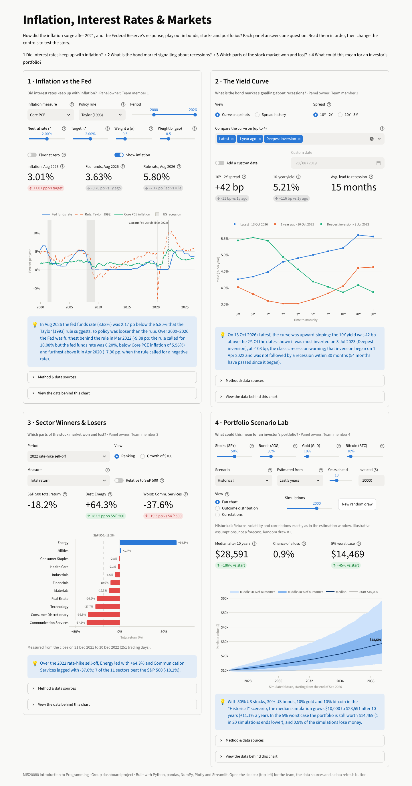

# Inflation, Interest Rates & Markets

A four-panel economics and finance dashboard written in Python for the MIS20080 Introduction to Programming group project.

In 2021 and 2022 US inflation rose to levels not seen for decades, and the Federal Reserve answered with a fast run of interest rate rises. The dashboard follows that story in four steps. Panel 1 asks whether interest rates kept up with inflation. Panel 2 looks at what the bond market expected, through the yield curve. Panel 3 shows which parts of the stock market won and lost. Panel 4 asks what all of this could mean for an investor's portfolio. Every panel has its own controls, so you can change the period, the model settings or the scenario and see the chart, the key numbers and the written insight update straight away.



## The four panels

| # | Panel | Question | Chart types | Controls | Data | Owner | Write-up |
|---|---|---|---|---|---|---|---|
| 1 | Inflation vs the Fed | Did interest rates keep up with inflation? | Line chart: fed funds rate vs a Taylor-rule rate vs inflation, with recession bands and the biggest gap marked | Inflation measure, policy-rule preset, period, four rule sliders (r\*, target, two weights), zero-floor toggle, show-inflation toggle | FRED: CPI, core CPI, core PCE, fed funds rate, unemployment, CBO natural rate | Team member 1 | [docs/panel1_inflation.md](docs/panel1_inflation.md) |
| 2 | The Yield Curve | What is the bond market signalling about recessions? | Spread history (area chart, red when inverted) with recession bands, shown first; yield curve snapshots (line + markers by maturity) | View, spread (10Y - 2Y or 10Y - 3M), period, recession shading, inversion rule sliders, dates to compare, custom date | FRED: daily Treasury yields from 3 months to 30 years | Team member 2 | [docs/panel2_yield_curve.md](docs/panel2_yield_curve.md) |
| 3 | Sector Winners & Losers | Which parts of the stock market won and lost? | Ranked horizontal bar chart; growth of $100 line chart with one sector highlighted | Period (presets, historical episodes or custom dates), view, measure (return, volatility, Sharpe ratio, drawdown, beta), relative-to-S&P 500 toggle, highlighted sector, risk-free rate | Yahoo Finance: SPY and the 11 SPDR sector ETFs | Team member 3 | [docs/panel3_sectors.md](docs/panel3_sectors.md) |
| 4 | Portfolio Scenario Lab | What could this mean for an investor's portfolio? | Monte Carlo fan chart, histogram of outcomes, correlation heatmap | Four portfolio weights, scenario, estimation window, years ahead, amount invested, view, number of simulations, new random draw | Yahoo Finance: SPY, AGG, GLD, BTC-USD | Team member 4 | [docs/panel4_portfolio.md](docs/panel4_portfolio.md) |

Every panel has the same layout: a header with its question, the controls, three key numbers, the chart, a one or two sentence insight computed from the data on screen, and two expanders with the method, the sources and a table of the plotted data (which you can download as CSV). The recession bands use NBER recession dates from FRED in panels 1, 2 and 3.

### Why Plotly rather than Matplotlib or Seaborn

Session 10 of the module teaches charts with Matplotlib and Seaborn. We used the same chart types from that session (line charts, a histogram, a heatmap, plus bar and area charts), but drew them with Plotly. The brief asks for a dashboard with dynamic controls for each chart, and Plotly charts are interactive inside a web page: you can hover over a point to read its exact value and date, zoom into a period, hide a series by clicking the legend and save the chart as a PNG. A Matplotlib or Seaborn chart in Streamlit is a fixed picture, so none of that would work. The ideas carry over directly: a Plotly figure is built up step by step like a Matplotlib figure (add the data, then set the axis titles, colours and legend), and `dashboard/theme.py` plays the role of a Matplotlib style sheet.

## Quick start

You need Python 3.10 or newer.

**Windows** (Command Prompt or PowerShell, in the project folder):

```bat
py -m venv .venv
.venv\Scripts\activate
pip install -r requirements.txt
streamlit run app.py
```

**macOS / Linux** (Terminal, in the project folder):

```bash
python3 -m venv .venv
source .venv/bin/activate
pip install -r requirements.txt
streamlit run app.py
```

Streamlit opens the dashboard in your browser at http://localhost:8501. Stop it with Ctrl+C in the terminal. Next time you only need to activate the environment (second line) and run `streamlit run app.py`.

The panels sit in a 2 x 2 grid on wide screens. On a window narrower than about 1200 px (or about 1550 px with the sidebar open) they are stacked in one column so the controls stay readable. The sidebar (the `>>` button at the top left) lists who owns each panel, shows how recent the saved data is and has the **Refresh data** button.

## Data: offline snapshots and refreshing

The dashboard reads its data from the CSV files in `data/`, so it runs without an internet connection and the numbers stay the same between hand-in and marking.

| File | Used by | Source |
|---|---|---|
| `inflation_macro.csv` | Panel 1 | FRED (monthly) |
| `yield_curve_treasury.csv` | Panel 2 | FRED (daily) |
| `sectors_prices.csv` | Panel 3 | Yahoo Finance (daily) |
| `portfolio_prices.csv` | Panel 4 | Yahoo Finance (daily) |
| `recessions.csv` | Panels 1-3 | FRED series USREC (monthly) |

To download the latest data, click **Refresh data** in the sidebar, or run:

```bash
python scripts/update_data.py
```

It prints `OK` or `FAILED` for each panel. If a download fails, the old snapshot is kept, so the dashboard never ends up with no data. Price files keep finished trading days only: today's row is left out because it keeps changing while markets are open. A refresh changes the numbers on screen and in the insights, so commit the new CSV files only when the team agrees.

FRED data downloads without an account. If you have a free FRED API key (from https://fred.stlouisfed.org/docs/api/api_key.html) you can set it and the official API is used instead:

```bash
export FRED_API_KEY=your_key_here          # macOS / Linux
$env:FRED_API_KEY = "your_key_here"        # Windows PowerShell
```

## Running the tests

```bash
python -m pytest -q
```

About 220 tests run in roughly 30 seconds and need no internet connection: the model functions are tested on small made-up data sets, and Streamlit's `AppTest` runs the whole dashboard and every panel headless from the snapshots in `data/`, including unusual control settings (empty selections, reversed dates, all-zero weights and so on).

| Test file | What it covers |
|---|---|
| `tests/test_app.py` | The whole dashboard draws with no errors and shows all four panels |
| `tests/test_data.py` | The shared data layer: snapshots, FRED and Yahoo downloads (faked), recession dates and which recessions fall inside a chart window |
| `tests/test_theme.py` | The shared chart style: background colour, legend spacing, recession bands and their legend entry |
| `tests/test_inflation.py`, `test_yield_curve.py`, `test_sectors.py`, `test_portfolio.py` | One file per panel: its calculations, insight sentences, charts and controls |

Run one panel's tests with, for example, `python -m pytest -q tests/test_sectors.py`.

Tested with Python 3.13 (Streamlit 1.66, pandas 3.0, NumPy 2.5, Plotly 7.1) and with the oldest versions in `requirements.txt`: Python 3.11 with Streamlit 1.40.0, pandas 2.2.0, NumPy 1.26.4 and Plotly 5.20.0. `requirements.txt` allows every version from those up to, but not including, the next major release of each package, so a big new release after hand-in can't break the dashboard.

## Working on one panel

Run a single panel on its own, at about the width it gets in the dashboard:

```bash
streamlit run scripts/preview_panel.py -- inflation
streamlit run scripts/preview_panel.py -- yield_curve
streamlit run scripts/preview_panel.py -- sectors
streamlit run scripts/preview_panel.py -- portfolio
```

While it runs you can switch panel in the address bar, e.g. `http://localhost:8501/?panel=sectors`. Streamlit notices when you save a file and offers to rerun the page.

Each panel module follows the same contract, so `app.py` can treat all four the same way:

- constants `NUMBER`, `SLUG`, `TITLE`, `OWNER` and `QUESTION`
- `refresh_data()` downloads fresh data for the panel
- `render()` draws the panel: header, controls, three key numbers, chart, insight, details
- inside the module: constants, then data loading, then the analysis functions (no Streamlit, so they can be unit tested), then the chart builders (return Plotly figures), then `render()`
- every widget key starts with the panel's slug (for example `sectors_period`), so keys never clash between panels
- colours and chart styling come from `dashboard/theme.py`, so the four panels look like one dashboard

## Project structure

```text
.
├── app.py                    the dashboard: header, sidebar and the 2 x 2 grid of panels
├── dashboard/
│   ├── data.py               shared data layer: FRED and Yahoo Finance downloads, CSV snapshots
│   ├── theme.py              shared colours and Plotly chart style
│   ├── ui.py                 shared Streamlit pieces: panel header, chart, insight, details
│   └── panels/
│       ├── __init__.py       the list of the four panels, in order
│       ├── inflation.py      Panel 1 · Inflation vs the Fed
│       ├── yield_curve.py    Panel 2 · The Yield Curve
│       ├── sectors.py        Panel 3 · Sector Winners & Losers
│       └── portfolio.py      Panel 4 · Portfolio Scenario Lab
├── data/                     CSV snapshots the dashboard runs from (offline)
├── docs/                     one write-up per panel, plus the screenshot above
├── scripts/
│   ├── preview_panel.py      run one panel on its own
│   └── update_data.py        download fresh data for every panel
├── tests/                    pytest tests: one file per panel, plus the shared ones
├── .streamlit/config.toml    page colours (they match the chart theme); hides the "Deploy" button
├── requirements.txt          Python packages needed
└── pyproject.toml            project details and pytest settings
```

## Team workflow

Each team member owns one panel and is responsible for three files:

| Panel | Code | Tests | Write-up |
|---|---|---|---|
| 1 | `dashboard/panels/inflation.py` | `tests/test_inflation.py` | `docs/panel1_inflation.md` |
| 2 | `dashboard/panels/yield_curve.py` | `tests/test_yield_curve.py` | `docs/panel2_yield_curve.md` |
| 3 | `dashboard/panels/sectors.py` | `tests/test_sectors.py` | `docs/panel3_sectors.md` |
| 4 | `dashboard/panels/portfolio.py` | `tests/test_portfolio.py` | `docs/panel4_portfolio.md` |

The shared files (`app.py`, `dashboard/data.py`, `theme.py`, `ui.py`, `requirements.txt` and this README) belong to the whole team. Agree changes to them together, because they affect every panel.

The code and the commits on GitHub are the proof of who did what, so please:

1. Put your name in your panel's `OWNER` constant (it replaces "Team member N" in the panel header and the sidebar), and in the owner column of the table at the top of this README.
2. Make the commits for your panel from your own GitHub account. Check that git uses your name and the email address of that account before you commit: `git config user.name` and `git config user.email` must show yours, not a teammate's or an assistant's left over from an earlier setup.
3. Commit small steps with clear messages, and run the tests before you push.

```bash
# once, on your own computer
git clone https://github.com/<team-account>/<repo-name>.git
cd <repo-name>
git config user.name "Your Name"
git config user.email "the-email-of-your-github-account@example.com"

# each time you work on your panel
git pull
python -m pytest -q tests/test_sectors.py          # your panel's tests
git add dashboard/panels/sectors.py tests/test_sectors.py docs/panel3_sectors.md
git commit -m "Panel 3: add the beta measure to the ranking"
git push

# see who changed what
git log --oneline --author="Your Name"
```

## Building the submission zip

Commit everything first, then build the zip from the latest commit:

```bash
git status                                    # should say "nothing to commit"
git archive --format=zip -o dashboard.zip HEAD
```

`git archive` packs exactly the files in the commit and nothing else (no `.venv`, no `__pycache__`, no `.git` folder). The zip contains `app.py`, the `dashboard/` package with the four panels, the CSV snapshots in `data/`, the write-ups and the screenshot in `docs/`, `scripts/`, `tests/`, `.streamlit/config.toml`, `requirements.txt`, `pyproject.toml` and this README. That is everything needed to run the dashboard: unzip it, follow the quick start above and run `streamlit run app.py`. No internet connection is needed after `pip install`. (The `*.zip` rule in `.gitignore` keeps the zip itself out of the repository.)

Files that are not committed are not in the zip. Uncommitted changes are left out too. So run `git status` first, every time.

## Before you submit

Work through this list together and tick each item off:

1. **Your own commits on GitHub.** Each member has made the commits for their own panel from their own GitHub account (see "Team workflow"). Never commit under someone else's name, and don't rewrite the git history to change who made a commit. The finished work is on the repository's default branch (`main`).
2. **Owner names.** Each member has put their own name in their panel's `OWNER` constant and in the owner column of the table at the top of this README.
3. **Use of generative AI.** Each member has written their own statement in the "Use of generative AI" section below.
4. **Clean and tested.** `git status` says "nothing to commit", `python -m pytest -q` passes, and the screenshot in `docs/` shows the current dashboard.
5. **The zip works.** Build it with `git archive`, unzip it into an empty folder and follow the quick start there (`pip install -r requirements.txt`, `python -m pytest -q`, `streamlit run app.py`). All four panels draw without errors.
6. **Learning journal.** Each student submits their own individual learning journal (about 5 pages, not counting references and appendices), using the module's template `12a.ECIS-inspired-template.docx`. Each student writes their own journal, about what they learned.

## Data sources and attribution

- **FRED, Federal Reserve Bank of St. Louis** (https://fred.stlouisfed.org). The series come from their original publishers: consumer prices (CPIAUCSL, CPILFESL) and unemployment (UNRATE) from the US Bureau of Labor Statistics; core PCE prices (PCEPILFE) from the US Bureau of Economic Analysis; the fed funds rate (FEDFUNDS) and Treasury yields (DGS3MO to DGS30) from the Board of Governors of the Federal Reserve System; the natural rate of unemployment (NROU) from the Congressional Budget Office; recession dates (USREC) based on the NBER business cycle dates. See the FRED terms of use: https://fred.stlouisfed.org/legal/.
- **Yahoo Finance**, downloaded with the open-source `yfinance` package (not affiliated with Yahoo): daily adjusted closing prices of SPY, the 11 SPDR sector ETFs (XLK, XLF, XLE, XLV, XLY, XLP, XLI, XLU, XLB, XLRE, XLC), AGG, GLD and BTC-USD. Yahoo Finance data is meant for personal use. The snapshots are included only so the dashboard can be run and marked offline; please don't reuse them for anything else.
- **Software:** Streamlit (Apache 2.0), Plotly (MIT), pandas (BSD 3-Clause), NumPy (BSD 3-Clause), requests (Apache 2.0), yfinance (Apache 2.0), pytest (MIT).

Each panel's "Method & data sources" expander links to the exact series it uses.

## Use of generative AI

Session 11 of the module covers generative AI tools, and UCD asks students to be open about how they used them.

> **To do before hand-in. Delete this box once all four statements are written.**
> Each team member writes their own statement below, in their own words, in a few sentences:
> - which AI tools you used, and what you used each one for (writing code, tests, explanations, text, debugging...);
> - which parts of your panel the AI wrote, and which parts you wrote yourself;
> - what you checked, tested, corrected or changed yourself, and how you know the numbers and the insight text are right.
>
> Be specific, and make sure the statements match the git history. The commits that are already in this repository have an AI coding assistant ("Claude") as their author. A marker can see that, so a statement that plays down the AI's part would contradict the evidence. Check the module's rules on AI use too.

**Team member 1 (Panel 1 · Inflation vs the Fed):** *to be written by Team member 1.*

**Team member 2 (Panel 2 · The Yield Curve):** *to be written by Team member 2.*

**Team member 3 (Panel 3 · Sector Winners & Losers):** *to be written by Team member 3.*

**Team member 4 (Panel 4 · Portfolio Scenario Lab):** *to be written by Team member 4.*

## Disclaimer

This dashboard is a university project for learning to program. It is for education only and is not investment advice. The Taylor rule, the inversion rule and the Monte Carlo scenarios are simple models with assumptions you can change on screen; past returns, especially bitcoin's, say little about future ones.
